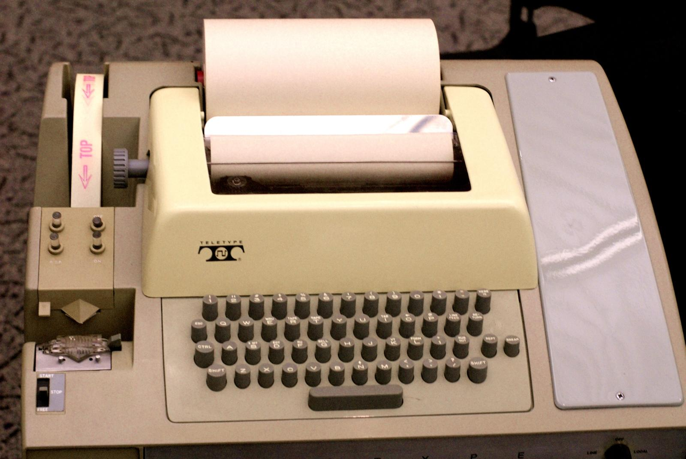

## History of Terminals and Teletypewriters
Before graphical user interfaces (GUIs) became common, users interacted with computers primarily through text-based interfaces.

Initially, computers were large machines that users couldn't interact with directly using a keyboard and monitor like we do today.

Instead, they used devices called teletypewriters (TTYs).



### What is a teletypewtiter?

A teletypewriter was an electromechanical device that allowed users to communicate with a computer through text.
- Physical terminals
- Virtual consoles (TTY1, TTY2, etc.)
- Terminal emulators
- TTY devices

### Why is TTY still used in Linux?
Although modern computers no longer need physical teletypewriters, the underlying terminal concepts remained useful.

Unix systems inherited the terminal device abstraction, and Linux continued this tradition.

That's why Linux still uses terminology such as:
```
TTY
/dev/tty
/dev/tty1
/dev/pts/0
```

