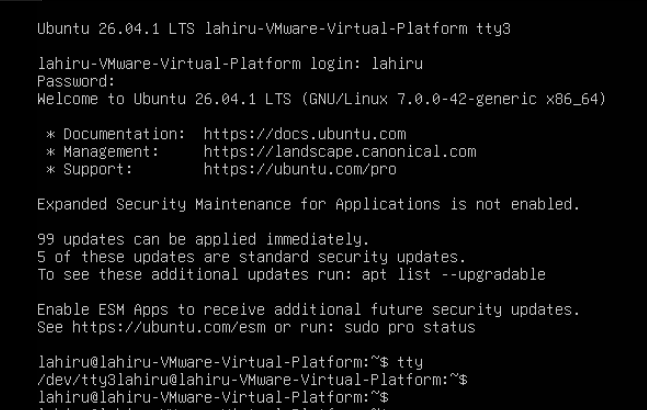
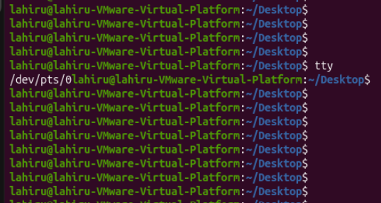

## History of Terminals and Teletypewriters
Before graphical user interfaces (GUIs) became common, users interacted with computers primarily through text-based interfaces.

Initially, computers were large machines that users couldn't interact with directly using a keyboard and monitor like we do today.

Instead, they used devices called teletypewriters (TTYs).


### What is a teletypewtiter?

A teletypewriter was an electromechanical device that allowed users to communicate with a computer through text.
- Physical terminals
- Virtual consoles (TTY1, TTY2, etc.)
- Terminal emulators
- TTY devices

### Why is TTY still used in Linux?
Although modern computers no longer need physical teletypewriters, the underlying terminal concepts remained useful.

Unix systems inherited the terminal device abstraction, and Linux continued this tradition.

That's why Linux still uses terminology such as:
```
TTY
/dev/tty
/dev/tty1
/dev/pts/0
```

### What are Virtual Consoles?
Engineers wanted to include multiple text-based terminal sessions to Linux system. So virtual console feature was introduced.
Virtual consoles are not necessarily separate physical terminals. They are software-based independent terminal interfaces provided by Linux.

Each virtual console can have its own login session and running shell.

For example:

| Virtual Console | Device File |
|---|---|
| TTY1 | `/dev/tty1` |
| TTY2 | `/dev/tty2` |
| TTY3 | `/dev/tty3` |
| TTY4 | `/dev/tty4` |

You can switch between virtual consoles using keyboard shortcuts.

| Keyboard Shortcut | Destination |
|---|---|
| `Ctrl + Alt + F1` | TTY1 |
| `Ctrl + Alt + F2` | TTY2 |
| `Ctrl + Alt + F3` | TTY3 |
| `Ctrl + Alt + F4` | TTY4 |

**Note:** The keyboard shortcuts may vary depending on the Linux distribution and desktop environment.

### Why does linux provide multiple virtual consoles?

They allow users to access different text-based sessions on the same machine.

For example:
- You can run a program in TTY2.
- You can log in separately in TTY3.
- You can troubleshoot the system through another console if the graphical desktop becomes unresponsive.

You can check which virtual console is using by typing, 
```bash
tty
```





